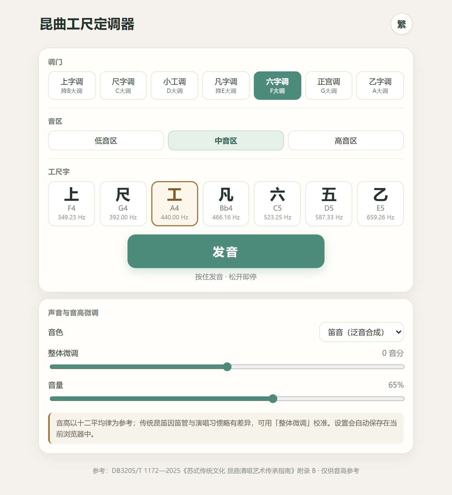
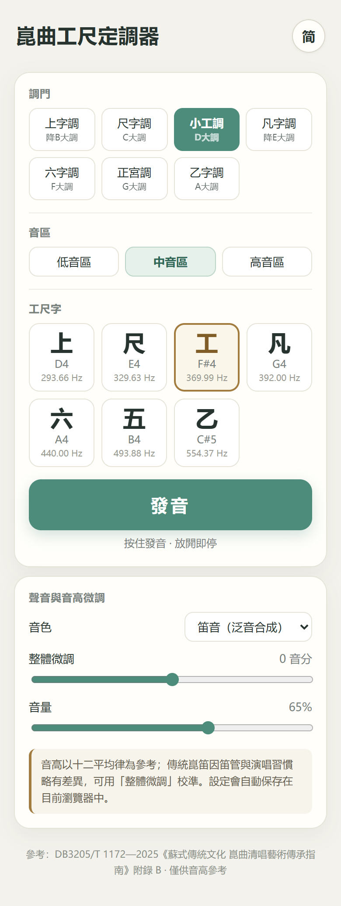

# 昆曲工尺定调器

日常拍曲想找个准音，打开网页就能起调，不用联网，也不用装依赖。如果习惯在手机上随手点开，仓库里也附带了原生 WebView 的 Android 打包脚本，几秒钟就能编出 APK。

## 界面预览

| 桌面端（简体 · 六字调） | 移动端（繁體 · 小工调） |
| :---: | :---: |
|  |  |

## 它能做什么

- **七调门与三音区**，覆盖上字调、尺字调、小工调、凡字调、六字调、正宫调、乙字调，搭配低、中、高三个音区，对应「上、尺、工、凡、六、五、乙」七个工尺音，每个音格里直接标出了十二平均律音名和频率。
- **按住即响，松开即停**，声音由浏览器内置的 Web Audio API 实时合成，可选笛音（泛音合成）或纯音（正弦波）。
- **音高微调**，传统昆笛受笛管和师承习惯影响，音高未必完全卡在十二平均律上，可以通过 `-50` 到 `+50` 音分的整体微调来对齐。
- **简繁切换与本地记忆**，点一下右上角的「繁 / 简」圆钮就能切换界面文字；调门、音区、音色、微调和音量都会保存在当前设备里，下次打开还是原来的设置。

## 目录结构

```text
gongche_tuner/
├── kunqu_gongche_tuner.html    # 单文件 Web 定调器源码
├── kunqu-gongche-tuner.apk     # 本地构建生成的 Android 安装包（默认不纳入 Git）
├── docs/                       # README 界面预览截图
│   ├── preview-desktop.png
│   └── preview-mobile.png
├── android/                    # 极简原生 WebView Android 工程
│   ├── AndroidManifest.xml
│   ├── build_apk.ps1           # 一键编译、签名、安装与启动脚本
│   ├── src/com/kunqu/gongchetuner/MainActivity.java
│   └── res/                    # 应用名称、主题样式与桌面图标资源
├── .gitignore
├── LICENSE
└── README.md
```

## 使用方式

### 1. 浏览器直接使用

在电脑或手机浏览器中直接打开 `kunqu_gongche_tuner.html` 就能离线使用。

### 2. 本地构建 Android APK

打包脚本直接调用本机 Android SDK 工具链（`aapt2`、`javac`、`d8`、`zipalign`、`apksigner`），不走 Gradle，几秒就能出包。

需要提前准备好 Windows PowerShell、Android SDK（含 `platforms` 与 `build-tools`），以及 JDK 11 及以上版本（如果装过 Android Studio，脚本会自动去检测内置的 `jbr`）。

```powershell
# 仅构建 APK（输出到项目根目录 kunqu-gongche-tuner.apk）
powershell -ExecutionPolicy Bypass -File android\build_apk.ps1

# 构建并通过 ADB 安装到已连接的 Android 手机后自动启动
powershell -ExecutionPolicy Bypass -File android\build_apk.ps1 -Install -Launch
```

每次构建都会自动把根目录最新的 `kunqu_gongche_tuner.html` 打进 APK，不用手动同步网页源码。

## 音高参考说明

- 音高计算依据 `DB3205/T 1172—2025`《苏式传统文化 昆曲清唱艺术传承指南》附录 B，采用十二平均律作为参考。
- 工具只作日常拍曲定调参考，替代不了老师的笛色、腔格与口传心授。

## 开源协议

本项目采用 [MIT License](LICENSE) 开源。
